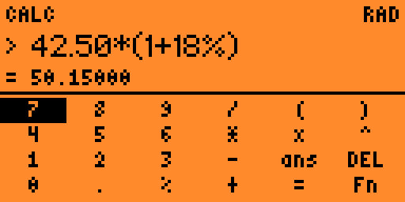
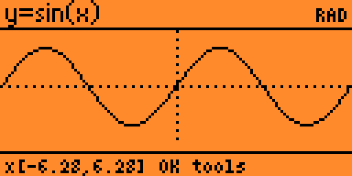
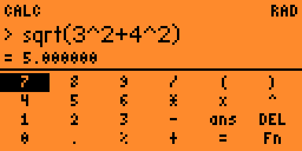

# Math-Wiz

Calculator and graphing app for Flipper Zero.

Enter expressions, reuse recent results, or graph a function. Supports powers, square roots, trig, logarithms, percentages, and DEG/RAD modes.

| Calculator | Graph |
| --- | --- |
|  |  |

## Controls

| Screen | Buttons |
| --- | --- |
| Menu | Up/Down to select, OK to open, Back to return or exit. |
| Calculator | Arrows to choose a key, OK to type. Hold OK to calculate. Back deletes; hold Back to return to the menu. |
| Function editor | Same controls as the calculator. Hold OK to plot. |
| Graph | Arrows to pan. OK opens zoom, trace, edit, and reset. Back returns to the menu. |
| Trace | Left/Right to move, Up/Down to zoom. OK opens graph tools. |
| Recent results | Up/Down to select, OK to reopen. |

`Fn` opens the function keys. `123` returns to numbers. `DEG`/`RAD` changes angle mode, `CLR` clears the expression, and `X=` sets the calculator's x value.

## Examples

- `42.50*(1+18%)` → `50.15`
- `sqrt(3^2+4^2)` → `5`
- `sin(30)` in DEG mode → `0.5`
- `x^2-4` or `sin(x)` to graph

Use `*` for multiplication, such as `2*x`. `%` divides by 100. `ans` uses the previous answer. Recent results are kept until the app closes.

[MIT license](license.md)
